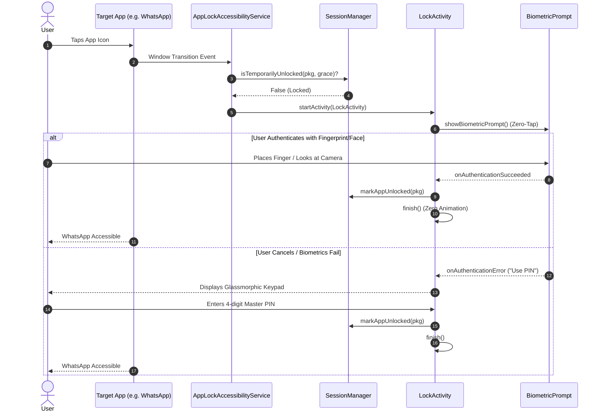

# Architecture

## System Overview
Pixel Guard is architected as an Android system-level application protection system. It intercepts target application foreground transitions in real-time, displays an isolated authentication layer before application interaction can occur, and coordinates session-based grace periods across the device lifecycle.

## System Diagram

```mermaid
graph TD
    User([User]) -->|Launches App| TargetApp[Target Protected App]
    OS[Android OS / SurfaceFlinger] -->|TYPE_WINDOW_STATE_CHANGED| A11yService[AppLockAccessibilityService]
    
    subgraph "Pixel Guard Core System"
        A11yService -->|Check Lock & Grace Period| SessionMgr[SessionManager]
        SessionMgr -->|Read Locked Set & Prefs| Repo[AppLockRepository]
        Repo -->|Preferences Flow| DataStore[(Jetpack DataStore)]
        
        SessionMgr -->|Lock Required| LockAct[LockActivity / OverlayWindowManager]
        LockAct -->|Hardware Auth| BioPrompt[BiometricPrompt: Titan M2 / Ultrasonic]
        LockAct -->|Custom Fallback| Keypad[Glassmorphic PIN Keypad]
        Keypad -->|PBKDF2 (200K iter) Check| Crypto[CryptoManager / Keystore]
        
        LockAct -->|Authentication Success| SessionMgr
        SessionMgr -->|Mark Temporary Session| InMemState[(In-Memory Session Cache)]
        LockAct -->|Authentication Failure >= 3| Camera[SilentCameraCapture: Camera2 Headless]
        Camera -->|Encrypted JPEG| Sandbox[(filesDir/intruders)]
        
        BioPrompt -->|Success| Dismiss[Dismiss LockActivity]
        Dismiss --> TargetApp
    end
```

## Tech Stack
- **Language**: Kotlin 2.0.21
- **UI Toolkit**: Jetpack Compose (BOM 2024.10.01) with Material 3
- **Architecture**: Clean Architecture + MVVM + Unidirectional Data Flow (UDF)
- **Asynchronous & Reactive**: Kotlin Coroutines & StateFlow / SharedFlow
- **Persistence**: Jetpack DataStore Preferences
- **Security & Crypto**: AndroidKeyStore (StrongBox/Titan M2), PBKDF2WithHmacSHA256 (200,000 iterations) with 16-byte secure salt
- **Biometrics**: AndroidX Biometric 1.2.0-alpha05 (`BiometricPrompt`)
- **Camera Capture**: AndroidX CameraX (`camera-camera2` headless pipeline)
- **Build System**: Gradle 8.10.2 + Android Gradle Plugin 8.7.2
- **Target SDK**: Android 15 / 16 / 17 (API 35, Java 17)

## Repository Structure
```
com.pixelguard.applock/
├── AppLockApplication.kt          # Global Application singleton, Notification channel setup
├── data/
│   ├── local/
│   │   ├── CryptoManager.kt       # PBKDF2WithHmacSHA256 salt & hash generator (200K iterations)
│   │   └── PreferencesDataStore.kt # DataStore preferences keys & Flow bindings
│   ├── model/
│   │   ├── AppCategory.kt         # FINANCIAL, SOCIAL, SENSITIVE, SYSTEM, OTHER
│   │   ├── AppItem.kt             # @Immutable app model with pre-rasterized 120x120 Bitmap
│   │   ├── IntruderRecord.kt      # Audit log model for intrusion captures
│   │   └── LockPreferences.kt     # Immutable settings state data class
│   └── repository/
│       ├── AppLockRepository.kt   # Repository domain contract
│       └── AppLockRepositoryImpl.kt # PackageManager loader & DataStore coordination
├── domain/
│   └── usecase/
│       └── SessionManager.kt      # State coordinator for grace periods & session unlocks
├── service/
│   ├── AppLockAccessibilityService.kt # Real-time window state listener
│   ├── AppLockForegroundService.kt    # Sticky foreground persistence service
│   ├── NotificationShieldService.kt   # NotificationListenerService privacy filter
│   ├── BootReceiver.kt                # BOOT_COMPLETED broadcast receiver
│   ├── camera/
│   │   └── SilentCameraCapture.kt     # Headless Camera2 front-facing photo capture
│   └── overlay/
│       ├── OverlayWindowManager.kt    # WindowManager TYPE_APPLICATION_OVERLAY manager
│       └── LockOverlayScreen.kt       # Compose lock interface & decoy crash dialog
└── ui/
    ├── main/
    │   ├── MainActivity.kt            # Edge-to-edge entry point & 120Hz display mode setter
    │   ├── MainViewModel.kt           # StateFlow provider & business logic
    │   └── MainScreen.kt              # App management dashboard & 1-tap batch controls
    ├── lock/
    │   └── LockActivity.kt            # Dedicated full-screen lock container with zero-tap biometrics
    ├── onboarding/
    │   └── OnboardingScreen.kt        # Android 17 permission setup wizard
    ├── settings/
    │   └── SettingsScreen.kt          # Security, timing, and stealth toggles
    ├── logs/
    │   └── IntruderLogsScreen.kt      # Intruder selfie audit gallery
    └── theme/
        ├── Color.kt, Theme.kt, Type.kt # Material You dynamic theming
```

## Application Layers
1. **Presentation Layer (`ui/`)**:
   - `MainActivity`: Orchestrates Compose navigation, sets `window.attributes.preferredDisplayModeId` for locked 120Hz rendering, and binds root lifecycle.
   - `MainViewModel`: Exposes immutable UI state flows (`filteredApps`, `preferences`, `permissionStatus`).
   - `LockActivity`: Dedicated transparent activity presenting `LockOverlayScreen` and managing `BiometricPrompt` lifecycle.
2. **Domain Layer (`domain/`)**:
   - `SessionManager`: Thread-safe singleton maintaining unlocked package timestamps, night lockdown windows, and per-app grace period logic in memory.
3. **Data Layer (`data/`)**:
   - `AppLockRepositoryImpl`: Queries installed apps via `PackageManager`, pre-rasterizes adaptive icons into 120x120 Bitmaps on `Dispatchers.IO`, and persists lock sets.
   - `PreferencesDataStore`: Encapsulates DataStore key-value reads/writes.
   - `CryptoManager`: Interfaces with cryptographic primitives.
4. **Service Layer (`service/`)**:
   - `AppLockAccessibilityService`: High-priority accessibility service receiving window transition events.
   - `SilentCameraCapture`: Headless Camera2 session connecting to the front sensor.

## Database Architecture
- **Storage Mechanism**: Jetpack DataStore Preferences (`pixel_app_lock_prefs`).
- **Keys**:
  - `locked_packages`: `Set<String>` of protected package identifiers.
  - `pin_hash`: PBKDF2WithHmacSHA256 hash (200,000 iterations) of the master PIN + salt.
  - `pin_salt`: Hex-encoded 16-byte cryptographically secure random salt.
  - `app_grace_periods_json`: JSON string map `{"com.example.app": 30}` for custom per-app timing.
  - Feature flags: Boolean preferences for haptics, animations, biometrics, schedule, decoy, recents masking.

## API Architecture
Pixel Guard does not connect to external REST/GraphQL APIs. It interacts exclusively with Android System Services:
- `AccessibilityService` (`TYPE_WINDOW_STATE_CHANGED`)
- `WindowManager` (`TYPE_APPLICATION_OVERLAY`, `FLAG_SECURE`)
- `BiometricManager` & `BiometricPrompt` (Class 3 Biometrics)
- `CameraManager` (Headless Camera2 front sensor capture)
- `NotificationListenerService` (`onNotificationPosted`)
- `Display` (`supportedModes`, `preferredDisplayModeId`)

## External Services
- **None**: Deliberate zero-external-dependency architecture. No third-party tracking, Firebase, or external network calls.

## Data Flow



## Architectural Patterns
- **Repository Pattern**: Abstracts storage implementation from business logic.
- **Unidirectional Data Flow**: State flows down from DataStore/ViewModel to Composables; events flow up via callbacks.
- **Pre-Rasterization Caching**: Icons are transformed on `Dispatchers.IO` to avoid UI-thread rasterization bottlenecks.

## System Boundaries
- **Interception Boundary**: Operates outside the target app's process space using system Accessibility hooks.
- **Credential Isolation Boundary**: Pixel Guard's Master PIN is isolated from Android's device lockscreen passcode.
- **Media Boundary**: Intruder photos reside in `context.filesDir/intruders`, strictly isolated from Android `MediaStore`.

## Scalability Considerations
- **Memory Footprint**: App icons are stored as downscaled 120x120 Bitmaps (approx. 57 KB each in ARGB_8888). 100 installed apps consume ~5.7 MB RAM.
- **Display Pipeline**: Pre-calculated grace maps and memoized category counts ensure O(1) lookups during 120Hz scroll.

## Security Architecture
- **Hardware Keystore & Key Stretching**: PBKDF2WithHmacSHA256 with 200,000 iterations and 16-byte random salt for PIN protection.
- **Class 3 Biometrics**: `BiometricManager.Authenticators.BIOMETRIC_STRONG` backed by Titan M2 hardware enclave.
- **Recents Masking**: `FLAG_SECURE` prevents OS snapshot caching in the overview recents tray.

## Deployment Architecture
- Packaged as a standalone APK (`app-debug.apk` / `app-release.apk`).
- Deployed directly via USB debugging (`adb install -r -d`) or local Android package installer.

## Architecture Decisions
- See [DECISIONS.md](file:///a:/Development/app-lock/docs/DECISIONS.md) for full context on architecture choices.

## Constraints
- Requires user to explicitly enable Accessibility Service and Overlay permissions.
- On Android 17, requires navigating "Allow restricted settings" in App Info for sideloaded APKs.
